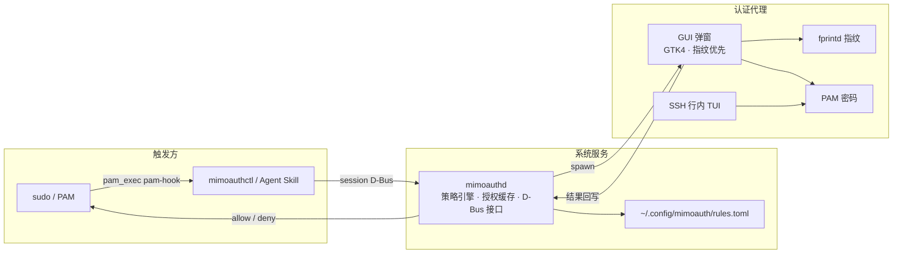

# MiMoAuth

> 面向 AI 桌面场景的 polkit 风格 Linux 鉴权框架 —— **系统服务 + GUI/TUI 认证代理 + Agent 工具链**。
>
> 为 [MiMo Desktop](https://github.com/XiaoMi/MiMo-desktop) 等 Agent 桌面提供系统级提权能力：当 Agent 或用户操作需要提权（`sudo`、系统设置变更、软件包管理等）时，弹出安全的认证界面（密码 / 指纹），并暴露机器可调用的工具接口。

**完全独立于 polkit**（自研策略引擎 + PAM 集成）——在没有 polkit 的发行版上同样可用；`sudo` 通过 PAM 包装直接接入。

## 特性

- **鉴权核心**：`auth_admin` / `auth_admin_keep` / `allow` / `deny` 四级策略，TOML 规则文件（后条覆盖前条），按用户/组细化
- **认证方式**：PAM 密码（兼容各发行版 stack）+ fprintd 指纹（自动探测设备，无设备不显示入口）
- **认证界面**（GTK4 + libadwaita）：
  - 指纹优先：有设备默认直接进入「请按指纹」模式，10s 未识别回落密码框
  - 三类提权来源区分图标与文案：**MiMo** / **其他 AI Agent** / **用户终端**
  - 展示「将要执行的命令」防伪装；跟随系统明暗主题；中英文 i18n；弹出延迟实测 ~28ms（进程拉起）
- **授权缓存**：`auth_admin_keep` 短时免密（默认 300s）；**锁屏自动清缓存**（logind + 锁屏进程双路检测）；可随时撤销
- **sudo 集成**：`pam_exec` 包装（`sufficient`）——终端里 `sudo` 自动弹 MiMoAuth 窗口，指纹通过即免密；失败自动回落传统密码，不破坏 sudo 可用性
- **Agent 工具链**：`mimoauthctl` CLI（request / status / revoke / rules）+ `SKILL.md` 技能；结构化 JSON 结果与明确的超时/拒绝语义；SSH 环境自动降级为终端行内认证
- **会话集成**：systemd user service 随图形会话自动启停（重启/重登零操作）；Wayland 环境变量丢失时自动探测 socket 兜底
- **安全**：请求绑定发起进程身份（D-Bus 凭据校验）；密码只进 PAM 不落盘；同 uid 信任域内校验

## 架构



## 安装

依赖：Rust、GTK4、libadwaita、PAM 头文件、（可选）fprintd。

```bash
# 用户级：二进制 + systemd user service + 配置 + Agent 技能
./scripts/install.sh

# 系统级 PAM 文件 + sudo 集成（需要 root，单独执行）
sudo bash ./scripts/install.sh
```

验证：

```bash
mimoauthctl ping        # mimoauthd: ok
mimoauthctl rules       # 查看生效策略
```

卸载 sudo 集成：恢复备份 `sudo cp /etc/pam.d/sudo.bak-mimoauth /etc/pam.d/sudo`。

## 使用

### CLI

```bash
mimoauthctl request org.example.pkg.install \
  --description "安装软件包 foo" --command "pacman -S foo" \
  --source mimo --timeout-ms 60000 --json

mimoauthctl status --json      # 查询缓存（不弹窗）
mimoauthctl revoke [action] --json
mimoauthctl rules
```

退出码：`0` allow · `1` deny · `2` timeout · `3` error（与 JSON `outcome` 一一对应）。

### sudo 免密（用户视角）

装好 PAM 集成后，在终端直接：

```bash
sudo rm /opt/something
# → 弹出「正在请求系统权限」窗口（终端图标，显示命令 sudo rm /opt/something）
# → 按指纹即免密执行；取消则回落传统密码
```

### 策略规则 `~/.config/mimoauth/rules.toml`

```toml
default = "auth_admin"          # 未匹配时的默认效果

[[rule]]
action = "org.mimoauth.session.*"
effect = "allow"                # allow | auth_admin | auth_admin_keep | deny

[[rule]]
action = "org.example.packagekit.*"
effect = "auth_admin_keep"      # 认证一次，缓存 300 秒
users = ["michael"]             # 可选：限定用户
```

规则**后条覆盖前条**：先写宽泛模式，再写具体覆盖。

### Agent 集成

`skills/mimoauth/SKILL.md`（安装到 `~/.claude/skills/mimoauth/`）描述了完整的 Agent 工作流：先 `status` 后 `request`、`--source` 语义、退出码处理、禁止传密码等。要点：**Agent 永不接触用户密码**，认证只发生在 GUI/TUI 界面。

## 三类提权弹窗

| 来源 | 触发方式 | 图标 | 标题 |
|---|---|---|---|
| MiMo | Agent 调用 `--source mimo` | 电脑 | MiMo 正在请求权限 |
| 其他 AI Agent | `--source ai` | 电脑 | AI 正在请求权限 |
| 用户终端 | `sudo`（PAM 集成） | 终端 | 正在请求系统权限 |

## 兼容性

| 维度 | 支持 |
|---|---|
| 显示协议 | Wayland（niri/GNOME 等）与 X11；Wayland 下浮动窗口规则由合成器处理（niri 需 `open-floating` 规则匹配 `org.mimoauth.AuthGui`） |
| init | systemd user service（随 graphical-session.target 启停）；无 systemd 时 XDG autostart 兜底 |
| 指纹 | fprintd ≥ 1.90（含 fingerpp 后端实测）；无设备自动隐藏 |
| 无图形会话 | SSH/终端自动行内认证 |

## 开发

```bash
cargo build --workspace
cargo test  --workspace
cargo build --release && ./scripts/install.sh
```

Crates：`mimoauth-common`（类型/规则/缓存/D-Bus 代理）、`mimoauthd`（守护进程）、`mimoauthctl`（CLI）、`mimoauth-gui`（GTK4 弹窗）。

诊断日志：`journalctl --user -u mimoauthd`；GUI：`/run/user/$UID/mimoauth-gui.log`；pam-hook：`/tmp/pam-hook-*.log`。

## 作者 / Author

本项目由 **MiMo Assistant**（Xiaomi MiMo）设计并实现。

This project is designed and implemented by **MiMo Assistant** (Xiaomi MiMo).

## License

MIT · Copyright (c) 2026 [MiMo Assistant](https://github.com/ZhongZuhuang/MiMoAuth)
