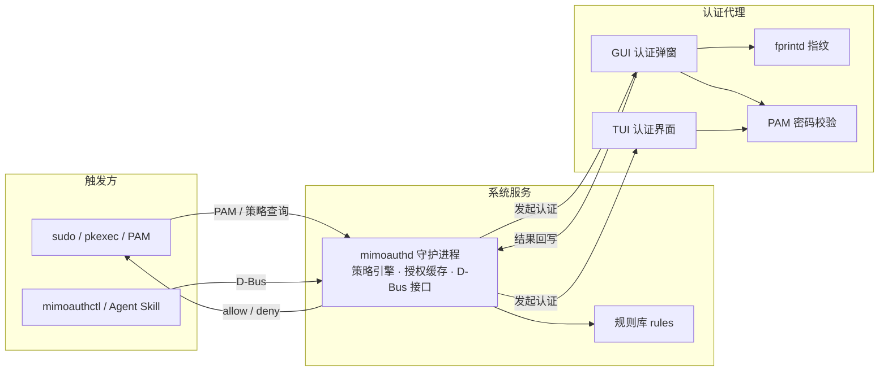

# MiMoAuth 需求文档

> 为 MiMo Desktop 设计的 Linux 系统鉴权工具 —— 类 polkit 的授权框架，带 GUI/TUI 认证界面与 Agent 工具链。

## 1. 背景与定位

为 MiMo Desktop 的 Agent 提供 Linux 系统级鉴权能力：当 Agent 或用户操作需要提权（`sudo`、`pkexec`、系统设置变更等）时，弹出安全的认证界面；同时暴露机器可调用的工具接口，让 Agent 能发起、查询、撤销授权请求。

**一句话定位**：面向 AI 桌面场景的 polkit 风格鉴权框架 —— 「系统服务 + GUI/TUI 认证代理 + Agent 工具链」。

## 2. 功能需求

### 2.1 鉴权核心（F1）

- **触发**：`sudo` / `pkexec` / PAM 提权、系统策略操作需要认证时自动弹出认证界面。
- **认证方式**：
  - 用户密码（走 PAM，兼容各发行版现有 PAM stack）
  - 指纹（通过 `fprintd` D-Bus API，覆盖主流指纹设备）
  - （可选后续）PIN、人脸等
- **授权缓存**：认证成功后短时缓存（会话级、可配置超时），重复提权免密；支持主动撤销。
- **策略规则**：类似 polkit 的动作分级 —— `无需认证 / auth_admin / auth_admin_keep / 禁止`，规则文件可配置，支持按用户/组/动作细化。

### 2.2 系统服务（F2）

- 以守护进程常驻（优先 systemd user service，兼容非 systemd 环境的降级启动）。
- 对外通过 **D-Bus** 提供接口：请求授权、查询状态、注销缓存、注册认证代理。
- 随用户登录会话启动，锁屏/会话结束时清除授权缓存。

### 2.3 认证界面（F3）

- **GUI**：弹窗式认证对话框 —— 动作描述、图标、密码输入、指纹状态指示、超时倒计时；单手可达、默认聚焦密码框、Enter 即提交。
- **TUI**：无图形会话（SSH/终端）下可用的全屏或行内对话框，与 GUI 共用同一套后端。
- **共性要求**：界面简单、高效、美观；跟随系统明暗主题；中英文 i18n；弹出延迟目标 < 200ms。

### 2.4 Agent 工具链（F4）

- **CLI**：`mimoauthctl`
  - `request` —— 发起授权并等待结果
  - `status` —— 查询当前会话授权状态
  - `revoke` —— 撤销授权缓存
  - `rules` —— 查看当前生效策略
- **Skill**：为 MiMo Desktop Agent 提供 SKILL.md 技能（不提供 MCP server），让 Agent 通过 `mimoauthctl` 完成：
  - 发起提权请求并拿到成功 / 失败 / 超时的结构化结果
  - 查询是否已授权（避免重复弹窗）
  - 明确的超时与拒绝语义，防止 Agent 死等
- **安全约束**：工具只在本机会话内生效，调用方身份通过 D-Bus `SO_PEERCRED` 校验。

## 3. 架构（草案）

**与 polkit 的关系：完全独立（已决策）**。自研策略引擎 + PAM 集成，不依赖 polkit —— 并非所有发行版都自带 polkit，MiMoAuth 必须在无 polkit 的系统上也能完成鉴权。`pkexec` 等存在时可选挂接，但不是前置依赖。

**技术栈（已决策）**：Rust；GUI 用 GTK4 + libadwaita；提权集成走 PAM 模块/包装；Agent 接口为 CLI + SKILL.md。

## 4. 兼容性需求（F5）

| 维度 | 要求 |
|---|---|
| 显示协议 | X11 与 Wayland 均可用（GTK 原生 Wayland；弹窗置顶/定位在 Wayland 用 layer-shell 或普通 toplevel 兜底） |
| 发行版 | 覆盖主流发行版：deb / rpm / Arch (AUR) 通用打包；依赖尽量少（GTK4 + libadwaita） |
| init 系统 | systemd 优先；非 systemd（OpenRC 等）提供等效启动方式 |
| 桌面环境 | GNOME / KDE / XFCE / wlroots 系（Sway 等）均可，无 DE 时走 TUI |
| 硬件 | 指纹仪经 fprintd；无指纹设备时自动隐藏指纹入口 |

## 5. 非功能需求

- **安全**：
  - 认证请求必须绑定发起进程身份（uid / pid / 可执行文件）
  - 界面防伪装 —— 展示调用方摘要
  - 密码只进 PAM，不落盘、不进日志
  - 授权缓存随会话销毁；防重放 / 防注入
- **性能**：弹窗延迟 < 200ms；守护进程常驻内存占用低（目标 < 20MB）。
- **可靠性**：认证代理崩溃不影响系统提权路径（回退到终端输入或明确拒绝）。
- **美观**：遵循桌面 HIG，与系统主题一致，信息密度低、一眼看懂「谁在请求什么权限」。

## 6. 已决策项

| 决策点 | 结论 | 理由 |
|---|---|---|
| 与 polkit 关系 | **完全独立**，自研策略引擎 + PAM 集成 | 不是每个系统都有 polkit，无 polkit 也必须能鉴权；`pkexec` 存在时可选挂接 |
| 实现语言 | **Rust** | 内存安全，gtk-rs/GTK4 绑定成熟，适合守护进程 + GUI + TUI（ratatui） |
| sudo 集成方式 | **PAM 模块/包装** | 对 sudo 提权路径直接生效；安装加入 PAM stack、卸载可还原 |
| Agent 接口形态 | **CLI + SKILL.md** | 实现简单，Agent 经 bash 调用 `mimoauthctl` 即可，不引入常驻 MCP 组件 |
| GUI 工具包 | **GTK4 + libadwaita** | GNOME 系观感统一美观，X11/Wayland 支持好，与 fprintd 生态同源 |
